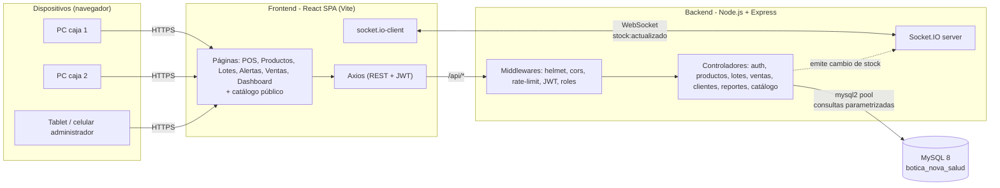
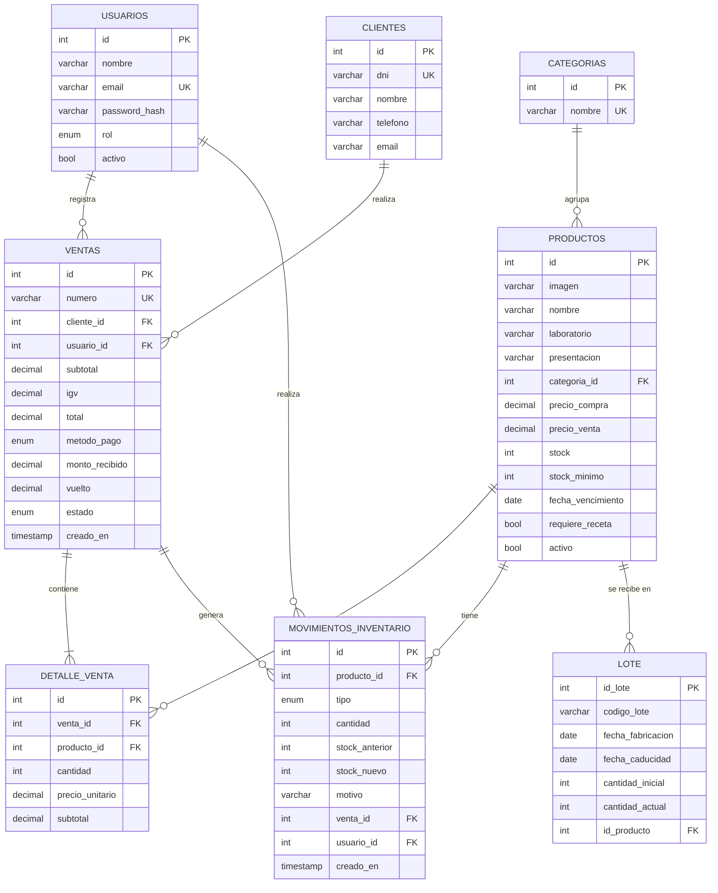
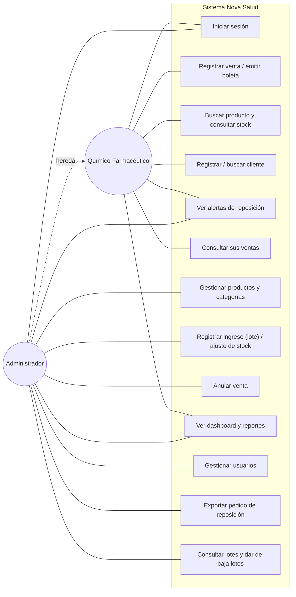
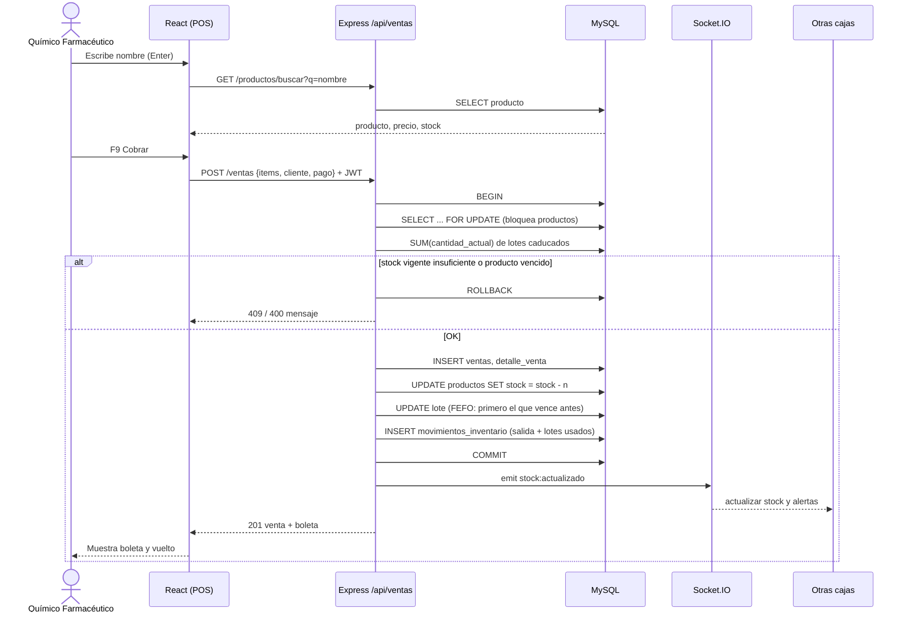
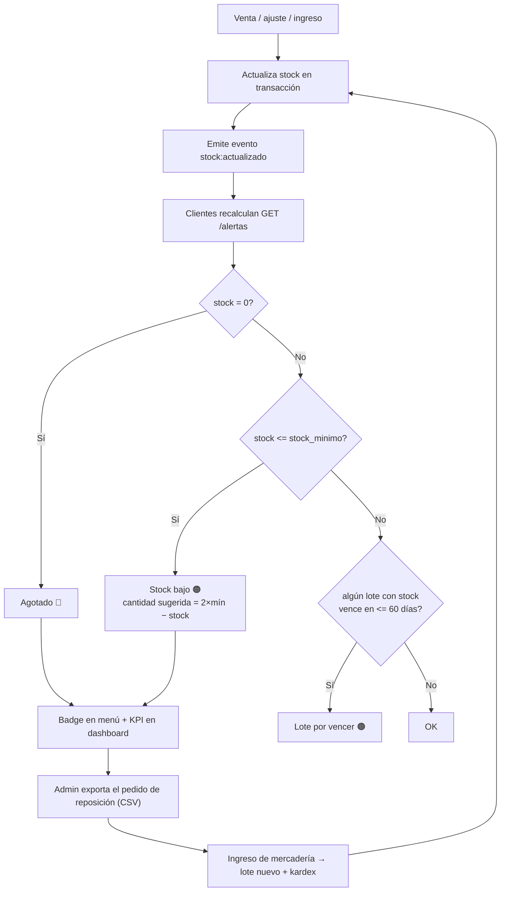
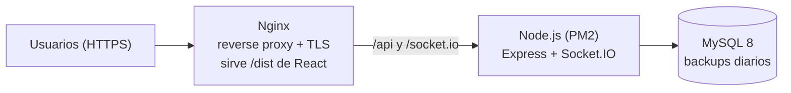
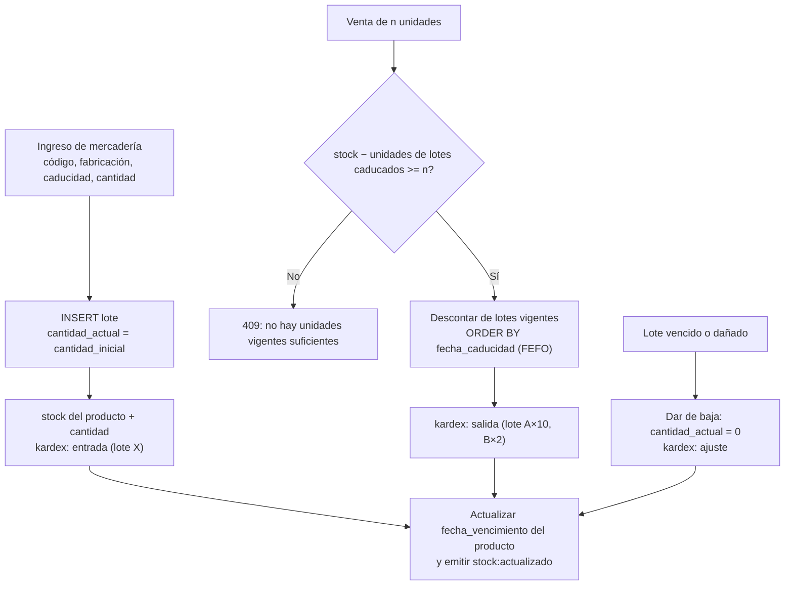

# Propuesta de solución — Botica "Nova Salud"

**Curso:** Fullstack Developer · **Tema:** Software web de gestión de inventario y venta de una botica
**Stack:** React (Vite) · Node.js + Express · MySQL 8 · Socket.IO · JWT

---

## 1. Problema

La botica Nova Salud controla su stock y su atención de forma manual. Eso le genera tres problemas:

| Problema | Consecuencia |
|---|---|
| Stock anotado a mano y sin conciliar con las ventas | Diferencias entre lo que dice el registro y lo que hay en el anaquel |
| Nadie avisa cuando un producto llega al mínimo | Desabastecimiento y ventas perdidas |
| Hay que buscar a mano el precio, la disponibilidad y el vencimiento | Colas largas y errores en el cobro |

## 2. Solución propuesta

Un **software web centralizado** con arquitectura cliente-servidor de tres capas:

- **Frontend (React SPA):** interfaz que funciona en PC, tablet o celular. Tiene un punto de venta pensado para atender rápido: búsqueda por nombre, atajos de teclado F2/F9 y cálculo automático del vuelto.
- **Backend (API REST con Express):** contiene la lógica de negocio, la autenticación con JWT, el control de roles y las transacciones de venta.
- **Base de datos (MySQL):** modelo relacional normalizado con integridad referencial y un kardex de movimientos.
- **Tiempo real (Socket.IO):** cada venta o ingreso de mercadería avisa a todas las cajas conectadas. Así se actualizan el stock y el contador de alertas sin recargar la página.

### Módulos

| Módulo | Funcionalidad |
|---|---|
| Autenticación y usuarios | Login con JWT, contraseñas cifradas con bcrypt, roles **administrador** y **químico farmacéutico**, activar o desactivar usuarios |
| Punto de venta | Búsqueda por nombre, carrito, cliente por DNI, efectivo, tarjeta o Yape/Plin, cálculo de IGV y vuelto, boleta imprimible |
| Productos | CRUD, categorías, stock mínimo, fecha de vencimiento (se actualiza sola con la próxima caducidad de sus lotes), marca de receta médica |
| Inventario (kardex) | Ingresos de mercadería, ajustes por conteo físico y trazabilidad completa (stock anterior y nuevo, usuario, motivo y lotes afectados) |
| **Lotes** | Cada ingreso registra un lote (código, fabricación, caducidad, cantidad inicial y actual). Las ventas descuentan primero el lote que vence antes (FEFO), las unidades de lotes caducados no se venden y los lotes se pueden dar de baja |
| Alertas | Productos agotados y con stock bajo; lotes por vencer (≤ 60 días) y vencidos. Cantidad sugerida de pedido y exportación del pedido a CSV |
| Ventas | Historial con filtros, detalle, reimpresión y anulación con devolución automática del stock (solo admin) |
| Clientes | Registro rápido desde la caja e historial de compras para fidelización |
| Catálogo público | Página de solo consulta para clientes: búsqueda, categorías, precio y disponibilidad (sin mostrar el stock exacto ni los productos con receta) |
| Dashboard | Ingresos del día y del mes, ticket promedio, gráfico de 7 días, productos más vendidos e inventario valorizado |

### Seguridad de los datos (Condición 1)

- Contraseñas guardadas con **bcrypt**; nunca en texto plano.
- **JWT** con expiración (8 h) en todas las rutas protegidas, incluido el canal de Socket.IO.
- **Autorización por rol** en el servidor. El frontend solo oculta botones; quien decide es el backend.
- **Consultas parametrizadas** (`mysql2`) para prevenir inyección SQL.
- **Helmet** (cabeceras HTTP seguras), **CORS** restringido al dominio del cliente y **rate-limit** en el login contra ataques de fuerza bruta.
- **Transacciones con `SELECT … FOR UPDATE`**: dos cajas no pueden vender la misma última unidad.
- Los precios de la venta se toman de la base de datos, no del navegador, para que no se puedan manipular.
- Baja lógica de productos: nunca se pierde el historial.
- En producción: HTTPS, `.env` fuera del repositorio y un usuario de MySQL con privilegios mínimos.

---

## 3. Respuestas a las preguntas guía

> El enunciado menciona "FarmaPlus" en las preguntas; se responden para el caso de **Nova Salud**.

### 1) ¿Cuáles son los principales desafíos operativos que enfrenta la botica debido a la falta de un sistema de gestión de inventarios automatizado?

1. **Desabastecimiento frecuente.** Nadie detecta a tiempo que un producto llegó a su mínimo, así que el pedido al proveedor se hace tarde.
2. **Inventario poco confiable.** Las salidas por venta no se descuentan al instante ni de forma sistemática. Aparecen diferencias por errores de anotación, merma o robo, y no hay trazabilidad para encontrar la causa.
3. **Tiempos de atención largos.** Para cada producto el químico farmacéutico tiene que confirmar a mano si hay, cuánto cuesta y si está vigente. Además calcula el total y el vuelto a mano.
4. **Productos vencidos.** Sin un control de fechas se vende o se pierde mercadería vencida, con riesgo sanitario y pérdida económica.
5. **Sin información para decidir.** No se sabe qué productos rotan más, cuánto se vende por día ni cuánto capital está inmovilizado en stock.
6. **Errores de cobro y de cuadre de caja**, y ningún registro formal de quién vendió qué.

### 2) ¿Qué características específicas debe incluir el software web para atender las necesidades de control de stock y atención al cliente?

**Control de stock**
- Catálogo de productos con foto, laboratorio, presentación, categoría, precio de compra y de venta.
- **Stock mínimo configurable** por producto y **alertas automáticas** (agotado, stock bajo, por vencer, vencido).
- Descuento automático y atómico del stock en cada venta. Devolución del stock si la venta se anula.
- **Kardex**: registro de cada entrada, salida, ajuste y anulación, con usuario, fecha y motivo.
- Ajustes por conteo físico con motivo obligatorio.
- Sugerencia de cantidad a pedir y exportación del pedido de reposición.
- **Control por lotes:** código de lote, fecha de fabricación y de caducidad, cantidad inicial y actual de cada ingreso.
- Despacho **FEFO** (primero el lote que vence antes) y baja de lotes vencidos o dañados.
- Bloqueo de la venta de productos y lotes vencidos.

**Atención al cliente**
- Punto de venta con búsqueda instantánea y búsqueda por nombre (Enter agrega el producto).
- Atajos de teclado: **F2** para buscar, **F9** para cobrar.
- Cálculo automático de IGV, total y vuelto, con montos sugeridos.
- Varios métodos de pago (efectivo, tarjeta, Yape/Plin).
- Identificación del cliente por DNI y registro rápido sin salir de la caja.
- Aviso cuando un producto requiere receta médica.
- Boleta imprimible en formato ticket de 80 mm.
- **Stock en tiempo real** entre varias cajas (Socket.IO).
- Diseño responsive para PC, tablet o celular.

### 3) ¿De qué manera la implementación de un software web para la gestión de inventarios puede impactar en la reducción del desabastecimiento y la mejora del servicio al cliente?

- **Reposición proactiva.** La alerta aparece *cuando* el stock cruza el mínimo, no cuando el cliente pide un producto que ya no hay. El sistema sugiere la cantidad a pedir (`2 × mínimo − stock`) y exporta la lista de reposición, con lo que el ciclo de pedido se acorta.
- **Visibilidad compartida.** Todas las cajas y el administrador ven el mismo stock al mismo tiempo. Ya no se promete un producto que no existe.
- **Rotación y vencimientos.** Como cada lote tiene su fecha de caducidad, la venta descuenta primero el que vence antes (FEFO) y la alerta "por vencer" señala el lote exacto, para priorizar su venta (con promociones, por ejemplo) o devolverlo antes de perderlo.
- **Atención más rápida.** Buscar, cobrar y entregar la boleta toma segundos. El químico farmacéutico no tiene que calcular nada ni revisar el anaquel para confirmar existencias.
- **Menos errores.** Los precios y totales salen de la base de datos y el vuelto se calcula solo. Además, el sistema no deja vender más de lo que existe.
- **Mejor experiencia.** Se reconoce al cliente frecuente por su DNI y se puede consultar su historial para recomendarle productos.

### 4) ¿Qué beneficios adicionales, aparte del control de inventarios, podría ofrecer el software para incrementar la competitividad de la botica en su mercado?

1. **Inteligencia de negocio:** dashboard con ingresos, ticket promedio, productos más vendidos y métodos de pago, para negociar con proveedores y planificar compras.
2. **Fidelización de clientes:** historial de compras por DNI que sirve de base para descuentos, programas de puntos o recordatorios de tratamientos crónicos.
3. **Pagos digitales** (Yape/Plin y tarjeta), que hoy los clientes esperan encontrar.
4. **Control interno y auditoría:** cada venta y movimiento queda registrado con el usuario que lo hizo, lo que reduce pérdidas y fraudes.
5. **Escalabilidad:** al ser web y centralizado, permite abrir una segunda sede o agregar cajas sin instalar nada en cada equipo.
6. **Bases para crecer:** la API REST permite integrar más adelante la facturación electrónica de SUNAT, ventas online con delivery a partir del catálogo público y recordatorios por WhatsApp.
7. **Cumplimiento sanitario:** control de vencimientos y de medicamentos con receta.
8. **Menor capital inmovilizado:** el inventario valorizado ayuda a comprar solo lo que rota.

### 5) ¿Qué métricas se pueden utilizar para evaluar la efectividad del software en mejorar los tiempos de respuesta al cliente y reducir los errores en la gestión de inventario?

| Dimensión | Métrica (KPI) | Cómo se mide | Meta sugerida |
|---|---|---|---|
| Atención | **Tiempo promedio de atención por venta** | Cronometrar una muestra antes y después; o diferencia entre `creado_en` de ventas consecutivas en hora punta | Reducir ≥ 50 % |
| Atención | **Ventas por hora por caja** | `COUNT(ventas) / horas de turno` | Aumentar |
| Atención | **Tiempo de espera en cola** | Muestreo en hora punta | < 3 min |
| Atención | **Satisfacción del cliente (CSAT/NPS)** | Encuesta breve | ≥ 85 % satisfechos |
| Inventario | **Exactitud de inventario (IRA)** | `ítems cuyo stock en sistema = conteo físico / ítems contados × 100` | ≥ 98 % |
| Inventario | **Tasa de quiebre de stock** | `% de productos con stock = 0` (módulo Alertas) | < 2 % |
| Inventario | **Ventas perdidas por falta de stock** | Registro de pedidos no atendidos | Tendencia a 0 |
| Inventario | **Mermas por vencimiento** | `Σ (unidades de lotes dados de baja por vencimiento × costo)` por mes | Reducir ≥ 70 % |
| Inventario | **Volumen de ajustes** | `Σ cantidad` en movimientos tipo *ajuste* (kardex) | Reducir mes a mes |
| Inventario | **Rotación de inventario** | `costo de ventas / inventario valorizado promedio` | Aumentar |
| Ventas | **Tasa de anulaciones** | `ventas anuladas / ventas totales` | < 1 % |
| Ventas | **Diferencias de cuadre de caja** | Efectivo contado − efectivo en el sistema | S/ 0 |
| Sistema | **Disponibilidad y tiempo de respuesta de la API** | Monitoreo (uptime, p95 de latencia) | 99.5 % / < 300 ms |

La mayoría de estas métricas se calculan directamente desde las tablas `ventas`, `detalle_venta`, `movimientos_inventario` y `lote`.

---

## 4. Diagramas

### 4.1 Arquitectura del sistema

### 4.2 Modelo entidad-relación

### 4.3 Casos de uso

### 4.4 Secuencia: registrar una venta

### 4.5 Flujo de alertas de reposición

### 4.6 Despliegue sugerido

---

## 5. Seguridad y salud en el trabajo, y medio ambiente

- **Ergonomía:** la interfaz de caja minimiza clics y uso del mouse (búsqueda por nombre y atajos de teclado), con buena legibilidad y contraste. Esto reduce la fatiga en jornadas largas.
- **Menos estrés operativo:** el cálculo automático evita los errores de caja que luego tiene que asumir el trabajador.
- **Medio ambiente:** menos papel (registros digitales en lugar de cuadernos; la boleta se imprime solo si el cliente la pide). El control de vencimientos por lote reduce el desecho de medicamentos y permite gestionar su devolución o eliminación responsable.
- **Normas técnicas:** código organizado por capas (MVC), API REST, base de datos normalizada (3FN) con integridad referencial y control de versiones con Git.

## 6. Conclusiones

El sistema cubre las cuatro exigencias del caso:

1. Gestión centralizada de inventario, ventas y clientes.
2. Registro de ventas transaccional y trazable.
3. Interfaz de caja optimizada para atender rápido.
4. Menos errores de inventario gracias al kardex, el control por lotes, las alertas automáticas y la validación de stock en el servidor.

A esto se suman la seguridad de los datos (JWT, bcrypt, roles, consultas parametrizadas) y el acceso desde cualquier dispositivo con navegador.

---

## 7. Anexo: control de lotes (FEFO)

Cada ingreso de mercadería se registra como un **lote** con su código (el impreso en la caja), fecha de fabricación, fecha de caducidad y cantidad. Así la botica sabe exactamente qué unidades vencen y cuándo, y puede responder ante el retiro sanitario de un lote específico.

Reglas que aplica el servidor dentro de la misma transacción de la venta o del movimiento:

- **Entrada:** crea el lote con `cantidad_actual = cantidad_inicial` y suma al stock del producto. No se permite repetir el código de lote en un mismo producto ni una caducidad anterior a la fabricación.
- **Venta (FEFO):** descuenta primero del lote vigente que vence antes. Las unidades de lotes caducados siguen en el stock hasta darlas de baja, pero no se pueden vender.
- **Anulación y ajuste por conteo:** devuelven o descuentan unidades en el mismo orden.
- **Baja de lote:** retira las unidades restantes (vencido, dañado, retiro sanitario) y la registra en el kardex como ajuste.
- La `fecha_vencimiento` del producto se mantiene igual a la próxima caducidad entre sus lotes con stock.

